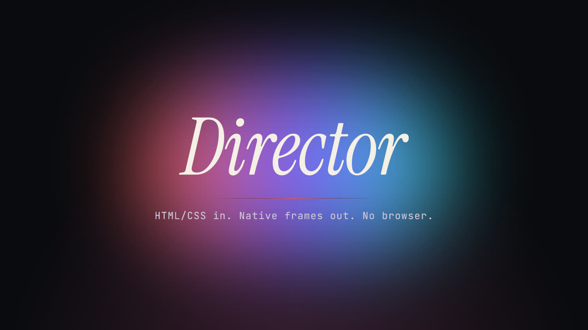

<h1>Steven Figler · Step Up Gaming</h1>

**Research code in. Native software out.**

I port ML models from PyTorch to Rust and [Candle](https://github.com/huggingface/candle), then build the software around them: CLIs, Tauri desktop apps, web apps and WASM builds. Step Up Gaming is the name I build under, though most of it has nothing to do with games anymore.

[Portfolio](https://stepupgaming.github.io/) · [steve@stepupai.com](mailto:steve@stepupai.com)

---

### Flagship

**[Director](https://github.com/stepupgaming/director)**: a native video engine in Rust that agents can drive.
HTML/CSS and HyperFrames compositions compile into a typed scene document. A parallel renderer paints it with Skia on a CPU pool or on Vulkan, and FFmpeg encodes, with no browser involved. `director-engine mcp` lets an agent open, patch, inspect and export a project over MCP. About 102k lines of Rust across 10 crates; pipelined 1080p export runs 2.13× faster than the serial path.

**[pocket-tts](https://github.com/stepupgaming/pocket-tts)**: the first Rust port of Kyutai's Pocket TTS. ⭐ 128
One binary on Candle with streaming, int8, an OpenAI-compatible HTTP API, a React UI, Python bindings and a WASM build for the browser. About 3× real time on CPU and 6× on Metal.

### Model ports

| Project | What it is |
| --- | --- |
| [parakeet-candle](https://github.com/stepupgaming/parakeet-candle) | NVIDIA Parakeet TDT 0.6B speech-to-text on Candle (v2 English, v3 multilingual) with token, word and sentence timestamps |
| [pycandle](https://github.com/stepupgaming/pycandle) | Transpiler from PyTorch (torch.fx) to Candle Rust: solves einsum, checks shapes, switches to flash attention |
| [ort-chatterbox](https://github.com/stepupgaming/ort-chatterbox) | Chatterbox Turbo TTS in Rust on ONNX Runtime: zero-shot voice cloning, FP32/FP16/Q8, streaming |
| [tauri-rustdocs-candle](https://github.com/stepupgaming/tauri-rustdocs-candle) | Semantic search over rustdoc with a Candle embedding model, as a Tauri app plus an MCP server |

### Apps and tools

| Project | What it is |
| --- | --- |
| [ClipFactory](https://github.com/stepupgaming/clipfactory) | Long footage in, vertical clips out, all local. [Live demo](https://stepupgaming.github.io/clipfactory/) |
| [VNCCS-Desktop](https://github.com/stepupgaming/VNCCS-Desktop) | Tauri + Next.js desktop app around the VNCCS ComfyUI pack |
| [magenta-windows](https://github.com/stepupgaming/magenta-windows) | Windows player for Google's Magenta RealTime music model |
| [comfy-workflows](https://github.com/stepupgaming/comfy-workflows) | Typed, code-first, composable ComfyUI workflows |
| [grits](https://github.com/stepupgaming/grits) | Git-native issue tracker for AI agents (`cargo install grits-cli`) |
| [slot-mechanics-dataset](https://github.com/stepupgaming/slot-mechanics-dataset) | Machine-readable slot-game mechanics, each with an evidence-based confidence level |

Private but shipping: **ThumbForge**, a local-first thumbnail studio for Qwen-Image · [**NoFaceTube**](https://nofacetube.com) · [**StepUpAI**](https://stepupai.com)

### Stack

`Rust` `Candle` `PyTorch` `ONNX Runtime` `WASM` `Skia` `Vulkan` `FFmpeg` `Tauri` `Next.js` `TypeScript` `Python`
